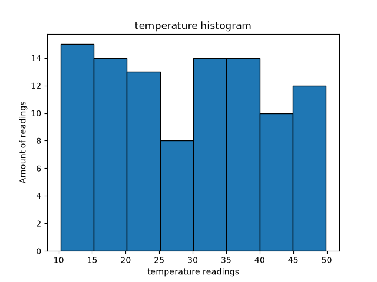

# Sensor Monitor
A simple program to visualize data from different kinds of sensors, you can either use a CSV file or let the program create data for you.
# Graphs

## Dependencies
* Python 3.x
* Numpy
* MatPlotLib

